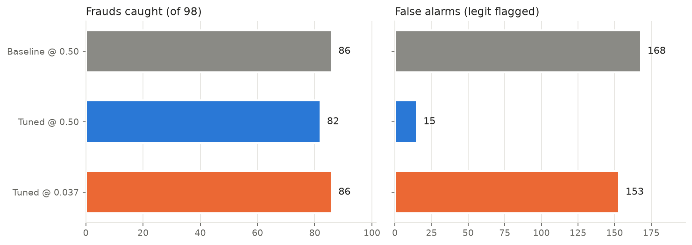
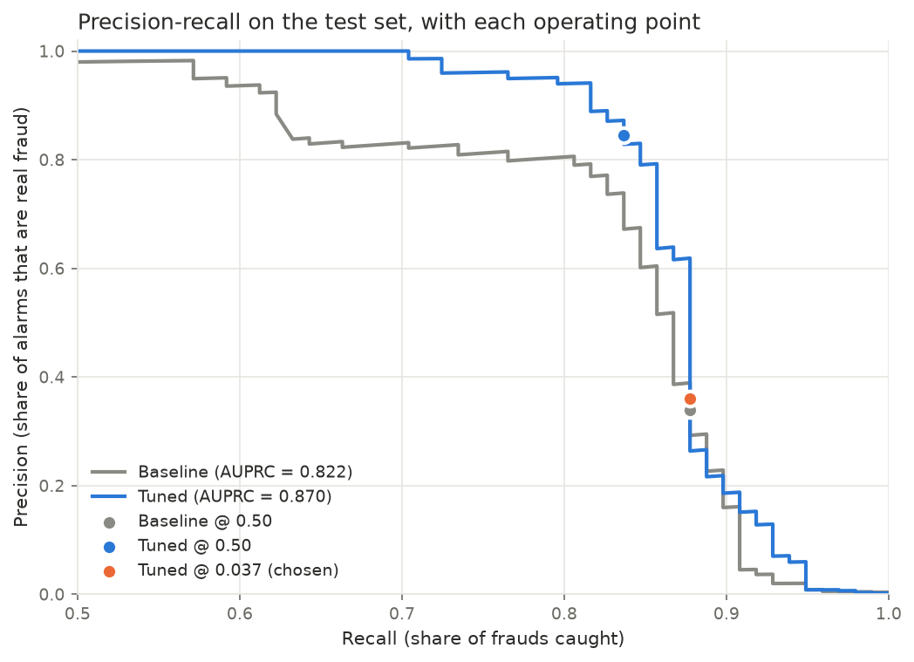
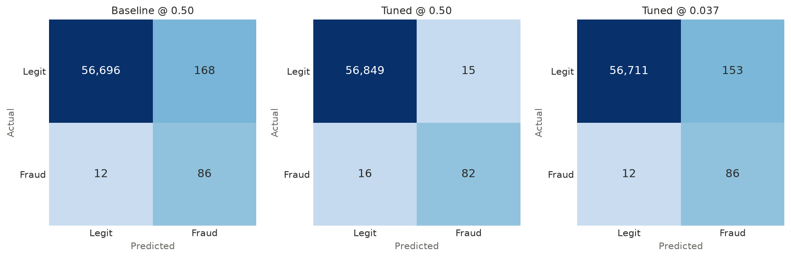

# Credit Card Fraud Detection MLOps Pipeline

An end-to-end Machine Learning pipeline for detecting credit card fraud, built to simulate production environments. This project goes beyond a Jupyter Notebook by incorporating data preprocessing, hyperparameter tuning, decision-threshold selection, experiment tracking (MLflow), a FastAPI backend, and Docker containerization.

## 📊 Dataset
- **Source:** [Kaggle Credit Card Fraud Detection](https://www.kaggle.com/datasets/mlg-ulb/creditcardfraud)
- **Size:** 284,807 transactions (492 frauds, 0.173%)
- **Challenge:** Extreme class imbalance. The held-out test set has 56,962 transactions and only **98 frauds**.

## 🏆 Results

Every model is scored on the same untouched test set (98 frauds, 56,864 legitimate transactions).

| Model | Threshold | Frauds caught (of 98) | Missed | False alarms | Precision | Recall |
|---|---|---|---|---|---|---|
| Baseline XGBoost | 0.50 | 86 | 12 | 168 | 33.9% | 87.8% |
| Tuned XGBoost | 0.50 | 82 | 16 | **15** | **84.5%** | 83.7% |
| **Tuned XGBoost (chosen)** | **0.037** | **86** | **12** | 153 | 36.0% | **87.8%** |

| | AUPRC |
|---|---|
| Baseline | 0.822 |
| Tuned | **0.870** |







### Why a lower threshold?
The tuned model ranks fraud better than the baseline (AUPRC 0.870 vs 0.822). At the default 0.50 cutoff, though, it misses 4 more frauds. In this problem a missed fraud is lost money, while a false alarm only costs an analyst a quick review. So the priority is **recall first**.

The threshold was chosen **without looking at the test set**:
1. Generated 5-fold out-of-fold predictions for the tuned model on the training set only.
2. Picked the target recall at the knee of that curve: **85%**. Moving from 82% to 85% recall costs a few hundred extra false alarms on the training data, but reaching 90% would cost thousands. A 90% target gave 1,714 false alarms on the test set.
3. Chose the highest threshold that still meets 85% recall (fewest false alarms for that recall): **0.037**.
4. Evaluated on the test set once at that threshold.

**Outcome:** the tuned model at 0.037 catches as many frauds as the baseline (86 of 98) with fewer false alarms (153 vs 168), and it comes from the model with the better AUPRC.

> With only 98 test frauds, a difference of a few frauds is within noise. The threshold is saved in `models/threshold.json`, so it can be changed if the business sets a different false-alarm budget.

## 🏗️ Architecture & Pipeline

1. **EDA (Notebook):** Explored class imbalance, amount skewness, and time-based fraud patterns (fraud peaks at 2 AM).
2. **Preprocessing (`src/preprocess.py`):**
   - Stratified 80/20 train/test split.
   - Log-transformed `Amount` to handle skewness.
   - Extracted `Hour` from `Time` and dropped raw time.
3. **Modeling (`src/train.py`):**
   - Trained a baseline XGBoost classifier.
   - Handled imbalance using `scale_pos_weight`.
   - Tuned hyperparameters with `GridSearchCV` (5-fold, optimized for average precision / AUPRC).
4. **Threshold selection & evaluation (`src/threshold.py`):**
   - Chose the decision threshold from out-of-fold training predictions (see above).
   - Evaluated all models on the test set and generated the figures in `reports/figures/`.
5. **Experiment Tracking (MLflow):**
   - Logged parameters, metrics (AUPRC, Recall, Precision), and model artifacts.
   - Tracked both Baseline and Tuned runs side-by-side.
6. **API (`api/main.py`):**
   - Built with FastAPI.
   - Replicates preprocessing logic (`preprocess_single`) for live inference.
   - Serves the **tuned model** and flags a transaction when its fraud probability is at or above the chosen threshold (read from `models/threshold.json`, currently 0.037).
7. **Containerization (`Dockerfile`):**
   - Packaged the API and dependencies into a `python:3.13-slim` image.

## 📂 Project Structure
```text
CC_Fraud_Detection/
├── api/
│   └── main.py               # FastAPI application and live preprocessing
├── data/
│   ├── creditcard.csv        # Raw dataset (ignored in Git)
│   └── processed/            # Train/test splits (ignored in Git)
├── models/                   # Saved models + threshold.json (ignored in Git)
├── notebooks/
│   └── 01_eda.ipynb          # Exploratory Data Analysis
├── reports/
│   └── figures/              # Result charts used in this README
├── src/
│   ├── preprocess.py         # Data cleaning and feature engineering
│   ├── train.py              # Baseline + GridSearchCV tuned model, MLflow logging
│   ├── tune.py               # Standalone grid search (exploration)
│   ├── evaluate.py           # Original confusion matrices and PR curve
│   └── threshold.py          # Threshold selection + final test evaluation
├── Dockerfile                # Container instructions
├── requirements.txt          # Python dependencies
└── README.md
```

## 🚀 How to Run

### 1. Setup & Preprocess
```bash
python -m venv .venv
source .venv/bin/activate  # Or .\.venv\Scripts\activate on Windows
pip install -r requirements.txt
python src/preprocess.py
```

### 2. Train, Choose Threshold & Track
```bash
python src/train.py
python src/threshold.py
# View MLflow UI:
mlflow ui --backend-store-uri sqlite:///mlflow.db
```

### 3. Run the API (Locally)
```bash
uvicorn api.main:app --reload
```
Go to http://127.0.0.1:8000/docs to test the endpoint.

### 4. Run with Docker
```bash
docker build -t fraud-api .
docker run -p 8000:8000 fraud-api
```
